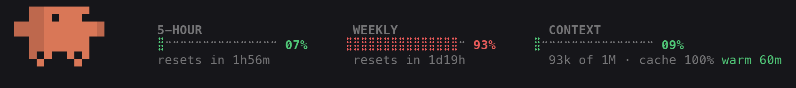
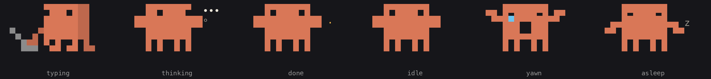

<div align="center">

# usage-deck

**Your Claude Code limits, context and prompt-cache warmth in one glance, with Clawd keeping you company.**



</div>

<br>

## Why

Claude Code tells you about your limits when you're already close to them, and nothing tells you when your prompt cache is about to go cold. usage-deck keeps all of it on screen in one compact band above the prompt:

| | |
|---|---|
| **5-hour and weekly limits** | dithered meters, green → yellow at 60% → red at 85%, with reset countdowns |
| **Context fill** | tokens used out of the window |
| **Cache warmth** | how much of the last turn came from cache, and a countdown until it goes cold. Send something before it turns red and the next turn doesn't pay to rebuild the cache |
| **Clawd** | animates with what Claude is doing |

## Clawd's moods



Clawd pulls out a laptop and types while tools run, thinks when a turn goes quiet, bounces when a turn finishes, looks around and yawns when idle, and falls asleep after ten minutes.

## Install

Needs Claude Code 2.1.287 or later (mods are on by default).

```
/plugin marketplace add codeclawd/usage-deck
/plugin install usage-deck@usage-deck
/reload-plugins
```

`/deck` hides or shows it.

## Behaves well

- Drops to a single row while a turn is running, so nothing gets cut off.
- Steps aside when another mod draws in the same band, like image previews.
- A limit window that just reset shows as `new window` instead of vanishing.

## Notes

- The cache countdown assumes the 1-hour prompt-cache TTL. On the 5-minute TTL it will still count down from 60.
- Limits come from the usage Claude Code reports after each turn, refreshed once a minute.

## Develop

```
npm ci
npm run typecheck
npm test
```

`npm run typecheck` runs `tsc` against the mods API types. When you load the mod with `claude --plugin-dir plugins/usage-deck`, Claude Code writes types for your version into `plugins/usage-deck/.claude-plugin/types/`, and the typecheck uses those. In a fresh clone or CI, `scripts/mod-types.mjs` fetches Anthropic's published copy at a pinned commit instead. `npm test` runs `claude plugin test` with the Claude Code version pinned in `package.json`.

## Credits

- **Clawd** is Claude Code's mascot, created by **[Anthropic](https://www.anthropic.com)**. The sprite and the poses here are hand-drawn for the terminal from Anthropic's own Clawd: the pixel mark and animations on [claude.dev](https://claude.dev) and the working-at-a-laptop animation in the Claude Code app. All credit for the character goes to them.
- Idle, thinking, yawning and sleeping poses are inspired by [Clawd on Desk](https://github.com/rullerzhou-afk/clawd-on-desk).
- Built on the [Claude Code mods](https://code.claude.com/docs/en/plugins/mods/overview) API.

This is an unofficial fan project and is not affiliated with or endorsed by Anthropic.

## License

Code: MIT. Clawd belongs to Anthropic.
